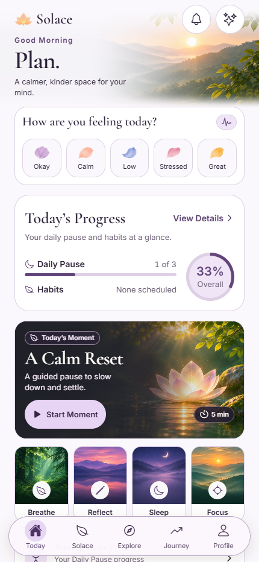
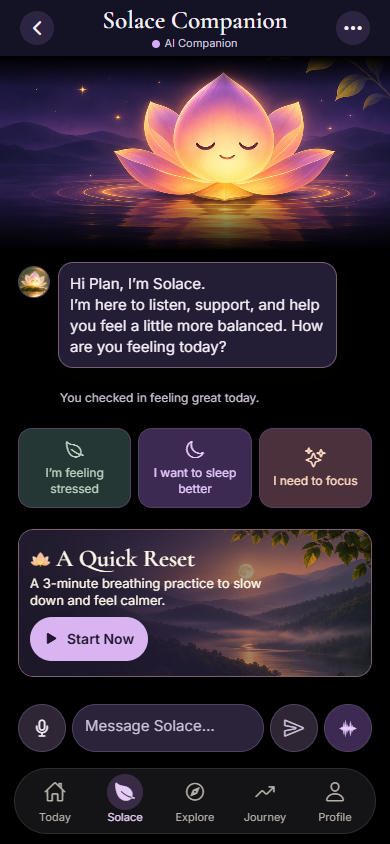
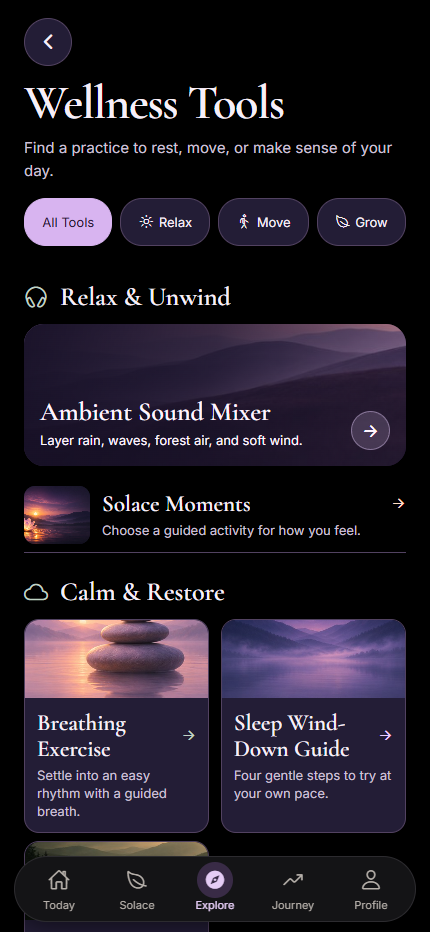

<p align="center">
  
</p>

<h1 align="center">Solace AI</h1>

<p align="center">
  A calmer, kinder space for your mind.
</p>

<p align="center">
  <a href="https://github.com/tejassambhus17/Solace/releases/tag/v1.0.0"><strong>Download Android APK</strong></a>
  &nbsp;·&nbsp;
  <a href="https://solace-demo-240e1d22-d2e6b3cahbheh2ed.centralindia-01.azurewebsites.net">Try the web preview</a>
  &nbsp;·&nbsp;
  <a href="https://github.com/tejassambhus17/Solace/releases/tag/v1.0.0">View release</a>
</p>

<p align="center">
  <sub>v1.0.0 · Android ARM64</sub>
</p>

Solace is a personal wellness companion. Check in with how you feel, talk things through by text or voice, or take a guided pause. Over time, your Journal and Journey give you a place to notice what helped.

<p align="center">
  
  
  
  <br>
  <sub>Today · Companion · Explore</sub>
</p>

## What you can do

- **Today** — Log a mood, follow your Daily Pause, or start a quick practice.
- **Solace** — Talk with the AI Companion by text or live voice, or write in My Journal. Companion can open practices and help set up habits or reminders with your approval.
- **Explore** — Find guided breathing, grounding, sleep and reflection practices. Build a timed session, mix ambient sounds, or save a practice to your toolkit.
- **Journey** — See the check-ins, practices and milestones you’ve recorded. Optional reflections after a practice help you notice what you found helpful. Track habits and grow your garden as you make progress.
- **Profile** — Choose wellness goals, manage reminders and appearance, and control personalization and account data.

## Install on Android

On an ARM64 Android device, open the downloaded APK and follow the system’s install prompts. Then open Solace and sign in or create an account.

## Run locally

Use Node.js 24. From the repository root:

```sh
npm run setup
npm run doctor
npm run dev
```

Setup installs the app and API dependencies. The development command starts the local API on port **3001** and Expo on port **8081**. For simulator, device, and environment setup, see the [local development guide](docs/LOCAL_DEVELOPMENT.md).

For live AI, set `OPENAI_API_KEY` in `server/.env` and select `AI_MODE=live`. The app can also run with labeled built-in guidance. Keep provider credentials on the server. See the [OpenAI setup guide](docs/OPENAI_MIGRATION.md).

## Under the hood

The app uses **React Native, Expo, and TypeScript**. A **Node.js API** stores account data in **SQLite** and connects to **OpenAI** for live AI features. The hosted preview runs on **Azure App Service**.

The mobile app lives in [`src/`](src/), the API in [`server/`](server/), and artwork and audio in [`assets/`](assets/). See the [architecture](docs/ARCHITECTURE.md), [release guide](docs/RELEASE.md), and [verification notes](docs/VERIFICATION.md).

## Privacy and scope

AI personalization is optional. Journal sharing with AI requires your approval of the selected excerpt. You can review saved preferences and export or delete your account data in Profile.

Solace supports everyday reflection and self-care. For clinical care or emergencies, seek qualified human support.
